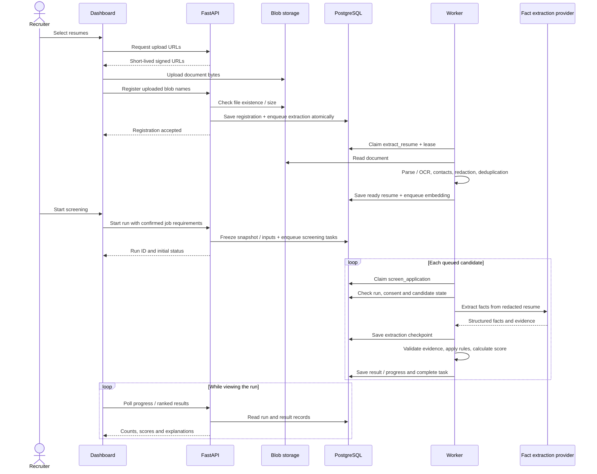
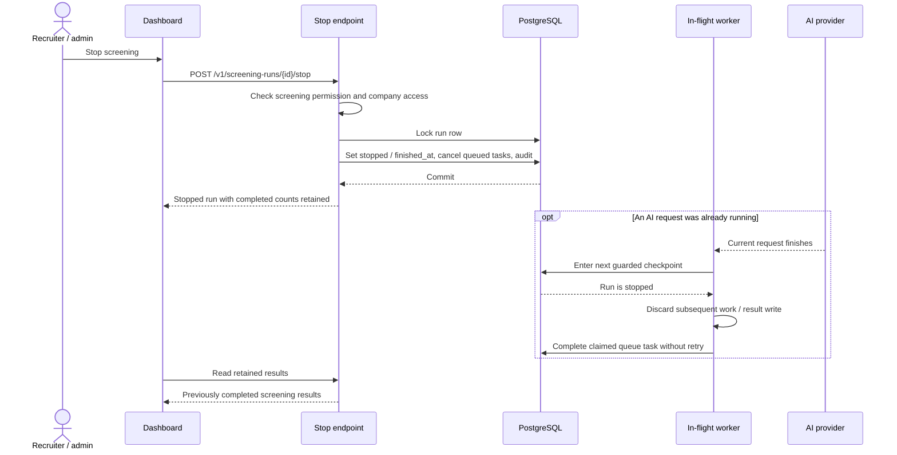
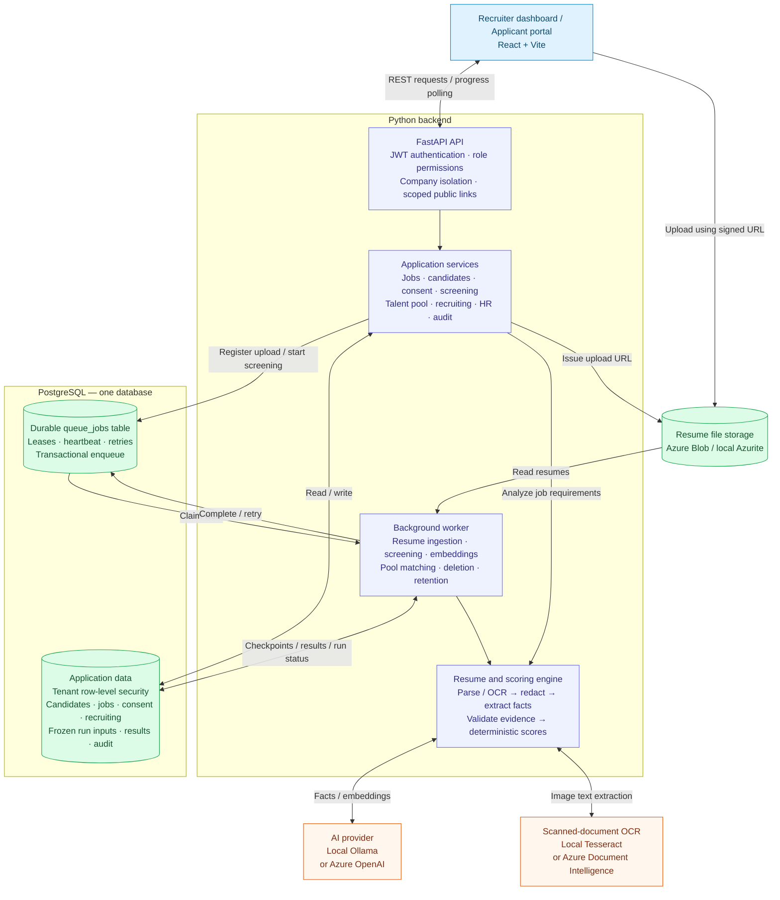

# Resume screening backend architecture

## Detailed component architecture

```mermaid
flowchart TB
    subgraph Clients["Client applications"]
        Staff["Recruiter / admin / hiring manager dashboard"]
        Public["Public applications / interview booking"]
    end

    subgraph APIProcess["FastAPI process — backend/main.py"]
        Auth["Staff authentication<br/>Argon2 passwords · JWT access tokens<br/>Rotating refresh tokens · role permissions"]
        Links["Public portal access<br/>Published application links<br/>Scoped interview booking links"]
        subgraph Routes["API modules"]
            Jobs["Jobs / requirement versions"]
            Candidates["Candidates / resume registration<br/>Consent / duplicates / exports"]
            Screening["Screening runs<br/>Start / retry / stop / results"]
            Pool["Talent pool / matching"]
            Recruiting["Pipeline / interviews / feedback<br/>Tasks / offers / reports"]
            HR["Hiring plans / HR records"]
            Drive["Google Drive import"]
        end
        Services["Business services<br/>Validation · run snapshots · audit events"]
        Tenant["Tenant repository / database sessions<br/>Company filters + transaction-local company context"]
        Health["Health / readiness checks<br/>Database roles + schema + storage"]
        Auth --> Routes
        Links --> Candidates
        Links --> Recruiting
        Routes --> Services
        Services --> Tenant
    end

    subgraph Storage["Persistent storage"]
        subgraph Postgres["PostgreSQL — shared database"]
            Identity[("Companies / users / refresh tokens")]
            Domain[("Jobs / candidates / resumes / consent<br/>Recruiting / HR / embeddings / pool matches")]
            Runs[("Runs / immutable snapshots / frozen inputs<br/>Extraction checkpoints / ranked results")]
            Audit[("Audit / usage / erasure tombstones")]
            Queue[("queue_jobs<br/>Transactional enqueue · idempotency keys<br/>Leases · retries · terminal status")]
        end
        Blobs[("Private resume files<br/>Azure Blob / local Azurite<br/>Company-prefixed object names")]
    end

    subgraph WorkerProcess["Separate worker process — backend/worker.py"]
        Dispatcher["Concurrent job dispatcher<br/>Row-locked claims · lease heartbeat<br/>Bounded retries / backoff"]
        Ingest["extract_resume<br/>Parse · contacts · redact · deduplicate"]
        Screen["screen_application<br/>Frozen inputs · extraction checkpoint<br/>Stop / consent / deletion guards"]
        Embed["embed_resume<br/>Candidate embeddings"]
        Match["match_pool / pool_check<br/>Eligibility and talent matching"]
        Privacy["delete_candidate / retention_sweep<br/>Records + blob cleanup"]
        Scheduler["Daily retention scheduler"]
        Dispatcher --> Ingest
        Dispatcher --> Screen
        Dispatcher --> Embed
        Dispatcher --> Match
        Dispatcher --> Privacy
    end

    subgraph Engine["Shared engine — engine/"]
        Parse["PDF / DOCX / TXT parsing<br/>Optional OCR"]
        Extract["Fact extraction<br/>Evidence validation"]
        Score["Knockout rules / feature calculation<br/>Deterministic scoring / explanations"]
        Semantic["Semantic similarity / embeddings<br/>TF-IDF fallback when configured"]
        Extract --> Score
    end

    subgraph Providers["Provider adapters — configuration chooses alternatives"]
        LLM["Ollama locally / Azure OpenAI<br/>Facts and embeddings"]
        OCR["Tesseract locally<br/>or Azure Document Intelligence"]
        Google["Google Drive"]
    end

    Staff -->|REST / result polling| Auth
    Public --> Links
    Staff -->|Signed upload| Blobs
    Public -->|Signed upload| Blobs
    Auth <--> Identity
    Tenant <--> Domain
    Tenant <--> Runs
    Tenant --> Audit
    Services -->|Enqueue within transaction| Queue
    Candidates -->|Generate signed upload URL| Blobs
    Google --> Drive
    Drive -->|Imported documents| Blobs
    Queue -->|Claim| Dispatcher
    Dispatcher -->|Renew / complete / retry| Queue
    Scheduler -->|Enqueue due company sweep| Queue
    Blobs --> Ingest
    Ingest --> Parse
    Parse --> OCR
    Ingest -->|Ready resume → embedding job| Queue
    Ingest --> Domain
    Screen <--> Runs
    Screen --> Extract
    Score -->|Result returned to handler| Screen
    Embed --> Semantic
    Match --> Semantic
    Embed --> Domain
    Match --> Domain
    Extract <--> LLM
    Semantic <--> LLM
    Services -->|Job requirement analysis| Extract
    Privacy --> Domain
    Privacy --> Blobs
    Privacy --> Audit
    Health -.-> Postgres
    Health -.-> Blobs

    classDef client fill:#e0f2fe,stroke:#0284c7;
    classDef service fill:#eef2ff,stroke:#6366f1;
    classDef data fill:#dcfce7,stroke:#16a34a;
    classDef external fill:#fff7ed,stroke:#ea580c;
    class Staff,Public client;
    class Auth,Links,Jobs,Candidates,Screening,Pool,Recruiting,HR,Drive,Services,Tenant,Health,Dispatcher,Ingest,Screen,Embed,Match,Privacy,Scheduler,Parse,Extract,Score,Semantic service;
    class Identity,Domain,Runs,Audit,Queue,Blobs data;
    class LLM,OCR,Google external;
```

The database boxes are logical groups inside one PostgreSQL database. Worker task boxes are handlers inside the worker process, rather than independently deployed services. Worker domain operations also use tenant-scoped database sessions; the dispatcher uses the system role to claim work across companies.

## Upload and screening sequence

Extraction may use cached or checkpointed facts instead of making a new provider request. The same engine supports rule-based extraction when configured without an LLM.

## Stop screening sequence

Stop and checkpoint writes serialize through database locks. Results committed before the stop remain; a running provider request is not forcibly terminated. A new screening run creates a new frozen snapshot.

## Security and operational boundaries

| Boundary | Enforcement |
| --- | --- |
| Staff access | JWT access tokens, rotating refresh tokens, role permissions; Argon2 password hashes |
| Public access | Published application and scoped booking links |
| Company data | Tenant repository filters plus PostgreSQL row-level security using transaction-local company context |
| Database roles | Application role subject to RLS; system role used for selected cross-company operations |
| Resume files | Private container, company-prefixed blob names, short-lived signed uploads and registration ownership checks |
| Screening reproducibility | Frozen requirements, settings / model identifiers, reference date and resume inputs; checkpointed extraction |
| Durable processing | Transactional enqueue, row-locked claims, lease renewal, bounded retries, idempotency and terminal bookkeeping |
| Privacy | Consent checks, redaction, contact hashes, deletion handlers, retention scheduling and erasure tombstones |
| Readiness | Database role / schema checks and storage probe; this does not guarantee AI provider availability |

## Local runtime layout

| Process / dependency | Local endpoint | Responsibility |
| --- | --- | --- |
| Vite frontend | `http://127.0.0.1:5173` | Dashboard / portal |
| FastAPI | `http://127.0.0.1:8000` | Platform API |
| Worker | No HTTP listener | Queued tasks and retention scheduler |
| PostgreSQL | `127.0.0.1:55432` | Domain records and durable queue |
| Azurite blob service | `127.0.0.1:10000` | Resume file storage |
| Ollama | `http://127.0.0.1:11434` | Local facts / embedding models |
| Tesseract | In-process/local OCR integration | Scanned resume text extraction |

These endpoints describe the current local development arrangement. Azure provider boxes represent supported configuration alternatives, rather than extra dependencies required by the local setup.

## Overview

This diagram reflects the website backend implemented in `backend/`, its separate worker, and the shared scoring engine in `engine/`.

## How a screening run moves through the system

1. The API gives the browser a signed upload URL. The browser uploads resumes to blob storage and registers them with the API.
2. The API records the registration and queues ingestion in PostgreSQL. The worker parses documents, runs OCR when needed, redacts sensitive text, and stores resume records.
3. Starting screening freezes the confirmed job requirements and resume inputs, then queues candidate screening tasks.
4. The worker extracts facts and validates evidence. The scoring engine applies deterministic rules and saves results. The dashboard polls the API for progress and ranked results.
5. Stop screening marks the run stopped and cancels queued screening work. Worker checkpoint guards prevent subsequent result writes; completed results remain available. An AI request already in progress may finish before its next checkpoint.

## Implementation notes

- API and worker are separate processes, sharing database, storage, and engine code.
- The active queue implementation is PostgreSQL, selected in `backend/runtime.py`.
- Tenant access uses company filters and PostgreSQL row-level security. A separate system database role handles cross-company queue claims and selected system operations.
- AI extracts facts and produces embeddings; final screening scores are calculated by the scoring engine.
- Provider boxes show supported alternatives. The current local setup uses Ollama, Tesseract, and Azurite.
- Google Drive import is an additional input path through the API into the same storage and ingestion workflow.
- The standalone engine API in `api/main.py` is separate from the website's FastAPI application in `backend/main.py`.

## Source map

| Component | Code |
| --- | --- |
| API and routes | `backend/main.py`, `backend/api/` |
| Resource wiring | `backend/runtime.py` |
| Business services | `backend/services/` |
| Database and tenant isolation | `backend/db.py`, `backend/models.py` |
| Durable queue | `backend/queue.py` |
| Background processing | `backend/worker.py` |
| File storage | `backend/storage.py` |
| Extraction and scoring | `engine/` |
| Stop screening | `backend/services/screening_control.py` |
